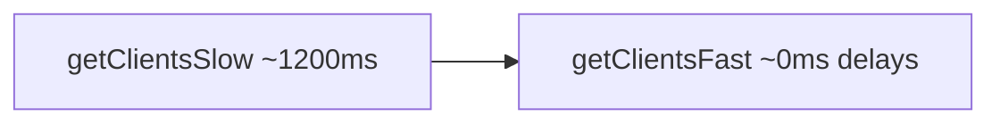

# Accelerar GET /api/clients (< 300 ms)

## Causa

[`src/app.js`](../src/app.js) crida `getClientsSlow()`, amb **tres** `await delay(400)` **seqüencials** (~1200 ms). Ja existeix [`getClientsFast()`](../src/db.js) sense delays i amb el mateix shape d’ítems (`id`, `name`, `company`, `owner`, `tags`).

**Decisió:** canviar l’endpoint a `getClientsFast`. Parallelitzar els delays no serveix: un sol `delay(400)` ja supera el límit de 300 ms.



## Passos ordenats

1. A [`src/app.js`](../src/app.js): importar `getClientsFast` en lloc de `getClientsSlow`.
2. Al handler `GET /api/clients`, substituir `await getClientsSlow()` per `await getClientsFast()`.
3. **No tocar** l’embolcall de resposta: seguir amb `res.json({ data, meta: { count, note } })`.

Canvi esperat (essència):

```js
// abans
const data = await getClientsSlow();

// després
const data = await getClientsFast();
```

## Fitxers

| Fitxer | Acció |
|--------|--------|
| [`src/app.js`](../src/app.js) | Únic canvi (import + crida) |
| [`src/db.js`](../src/db.js) | Sense canvis (ja té `getClientsFast`) |

## Riscos

- **Fals positiu amb parallelitzar:** `Promise.all` de tres delays de 400 ms ≈ 400 ms → encara > 300 ms.
- **`meta.note`:** pot continuar dient «endpoint lent (lab)»; no afecta el format ni el temps.
